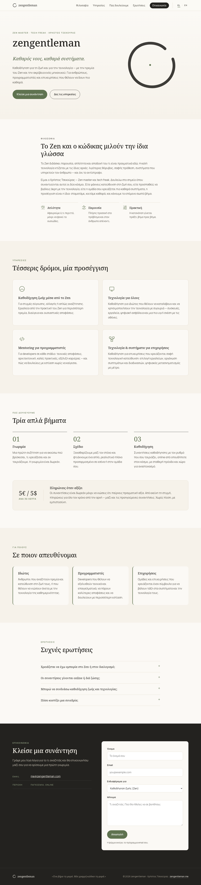
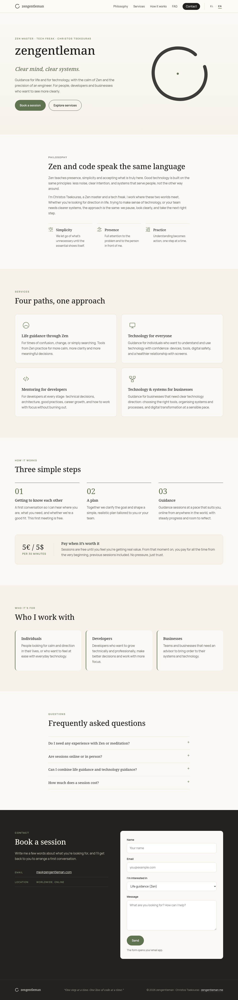

# zengentleman

Static website for [zengentleman.me](https://zengentleman.me): Zen and technology guidance by Christos Tsekouras.

The site is bilingual. Greek is the default language; English is available from the EL / EN switch or by opening `?lang=en`.

## Files

These are plain static files. There is no build step and no package install.

| File | Role |
| --- | --- |
| `index.html` | Page markup |
| `styles.css` | Layout and visual design |
| `script.js` | Language switching, navigation, and small interactions |

To view it locally, open `index.html` in a browser, or serve the repository root with any static file server:

```sh
python3 -m http.server
```

Then visit `http://localhost:8000/`.

## Preview

Desktop and mobile screenshots of the Greek and English versions:

| Greek | English |
| --- | --- |
|  |  |
|  |  |

## Domain

The intended public domain is `zengentleman.me`. A GitHub Pages `CNAME` file is not included yet, because DNS for that domain is not set up.
